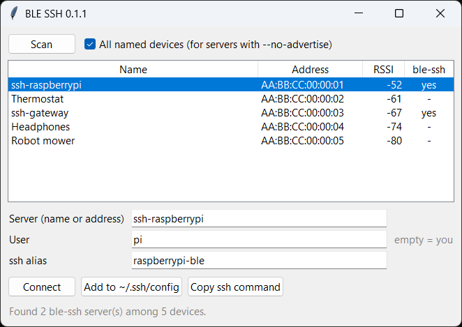

# ble-ssh

SSH over Bluetooth Low Energy. Handy for reaching a headless Linux box (e.g. a Raspberry Pi)
when the network is down or not configured yet.

```
ssh ──stdin/stdout── ble_ssh_client  ~~~ BLE GATT ~~~  ble_ssh_server ──TCP── sshd :22
     (ProxyCommand)     (central)                       (peripheral)
```

The tunnel only moves bytes; authentication and encryption are plain SSH, so nothing about
your sshd setup changes. The server handles several clients at once: every central that
subscribes gets its own TCP connection to sshd.

Built on [bluez_inc](https://github.com/twomas/bluez_inc) (submodule in `external/bluez_inc`).

## Demo

A Raspberry Pi 5 logging in to another Pi over Bluetooth LE only:

```console
pi@client:~$ ssh -o ProxyCommand="ble_ssh_client AA:BB:CC:DD:EE:FF" pi@server
pi@server's password:
Linux server 6.12.109+rpt-rpi-2712 #1 SMP PREEMPT Debian 1:6.12.109-1+rpt1 aarch64
...
pi@server:~ $ echo $SSH_CONNECTION
127.0.0.1 41628 127.0.0.1 22
```

sshd sees the session coming from `127.0.0.1`: the bytes arrived over BLE, not the network.

## Build

Requires Linux with BlueZ 5.x, CMake >= 3.16 and GLib/GIO headers (GLib 2.58 or newer).
The code only uses the GLib 2.58 API, so a binary built on a new distribution also runs on a
device with an older GLib.

```bash
sudo apt install build-essential cmake pkg-config libglib2.0-dev
git clone --recurse-submodules <repo-url> ble-ssh
cd ble-ssh
cmake -B build -DCMAKE_BUILD_TYPE=Release
cmake --build build
```

## Server

Try it in the foreground first:

```bash
./build/ble_ssh_server            # advertises as ssh-<hostname>, forwards to 127.0.0.1:22
./build/ble_ssh_server --help     # --port, --host, --name, --adapter-name, --max-clients,
                                  # --no-advertise, --no-power-on, --require-bonding, --verbose
```

To advertise under the name the device already has, use `--adapter-name`: the server
advertises the adapter's Bluetooth name (its `Alias`) and follows it when it changes, so it
doesn't matter whether the program that sets the name starts before or after ble-ssh.

### Next to another BLE peripheral

If another program on the same adapter already advertises (your product's own GATT server,
for example), run ble-ssh with `--no-advertise`:

```bash
./build/ble_ssh_server --no-advertise
```

BlueZ shares one GATT database between all applications on an adapter. A central that
connects through the other program's advertisement therefore sees both services, and the
two programs don't interfere with each other. Clients then connect by the name the other
program advertises, or by Bluetooth address (`ble_ssh_client AA:BB:CC:DD:EE:FF`). Both
clients look names up in any advertisement and check for the ble-ssh service once
connected, so a device with that name that doesn't run ble-ssh fails with "does not offer
the ble-ssh service".

ble-ssh never changes adapter-wide settings: pairable, discoverable, the pairing agent and
the alias are all left to the other program. The only exception is power: by default the
server powers on an adapter that is off. Add `--no-power-on` if the other program owns
adapter power too (for example a low-power mode). The GATT service is registered while the
adapter is off and becomes reachable when the other program powers it on.

```bash
./build/ble_ssh_server --no-advertise --no-power-on
```

By default the tunnel's characteristics don't require encryption, so ble-ssh never triggers
pairing on its own.

### Bonded clients only (`--require-bonding`)

Off by default. With `--require-bonding` the RX/TX characteristics require an encrypted
link, and the server only opens a session for centrals that bluetoothd reports as **bonded**.
Other centrals are disconnected before any byte reaches sshd.

ble-ssh doesn't pair anyone itself. Whether a new client may bond is decided by whatever
owns the adapter's agent and pairable setting: your own GATT server, or `bluetoothctl`
during development. Revoking a client is `bluetoothctl remove <address>` on the server.

```bash
./build/ble_ssh_server --no-advertise --no-power-on --require-bonding
ble_ssh_client --pair AA:BB:CC:DD:EE:FF      # first time: bond, then connect
ble_ssh_client AA:BB:CC:DD:EE:FF             # later: already bonded
```

On the peripheral side, bluetoothd only reports a new bond once that first link drops. So
`--pair` bonds, disconnects and reconnects, and the second link is the one the server
accepts. Other clients (e.g. a phone app) see the same thing: the first connection after
pairing is rejected, and the next one works. SSH still provides its own end-to-end
encryption and authentication on top.

For the systemd service, set the options in `/etc/default/ble-ssh` (see below).

### Run as a systemd service

```bash
sudo cmake --install build                  # binaries, unit and sysusers.d file under the prefix
sudo systemd-sysusers                       # creates the ble-ssh system user
sudo install -m 0644 systemd/ble-ssh.default /etc/default/ble-ssh   # optional settings
sudo systemctl daemon-reload
sudo systemctl enable --now ble-ssh-server
systemctl status ble-ssh-server             # shows e.g. "Status: 1/4 clients connected"
journalctl -u ble-ssh-server -f
```

With the default prefix `/usr/local` the unit lands in `/usr/local/lib/systemd/system`, which
systemd searches. Distribution and buildroot packages use `-DCMAKE_INSTALL_PREFIX=/usr`; the
unit's `ExecStart` is generated from the prefix, so it always points at the installed binary.

What the unit does:

| Concern | How |
|---------|-----|
| Startup | `Type=notify`: the service counts as started only once the GATT service is registered and advertising has started. `STATUS=` reports connected clients in `systemctl status`. |
| Hang detection | `WatchdogSec=30`: the GLib main loop pings systemd. If it stalls, systemd restarts the service. |
| bluetoothd lifecycle | The GATT service and advertisement live inside `bluetoothd`. `PartOf=bluetooth.service` restarts and stops ble-ssh together with it, and `WantedBy=bluetooth.service` starts it whenever bluetoothd starts. If bluetoothd crashes, the server notices `org.bluez` leaving the bus, exits with an error, and `Restart=always` brings it back. |
| Options | `/etc/default/ble-ssh` sets `BLE_SSH_OPTS`, e.g. `--no-advertise` or `--port 2222`. The file is optional. |
| Privileges | Runs as the static system user `ble-ssh` (from `sysusers.d`) in a strict sandbox (`systemd-analyze security` rates it 1.3, "OK"). It only needs the system D-Bus and a loopback TCP connection to sshd. `DynamicUser=` isn't used because the classic `dbus-daemon` rejects dynamic users on the system bus. |

### Install a release

Step by step, for a target and for client computers: [docs/install.md](docs/install.md).

Every GitHub release, and the pre-release `main-latest` that each push to main rebuilds,
has prebuilt binaries for arm64 and x86_64 (glibc 2.35 or newer). Downloading needs no
login. `ble-ssh-<arch>.tar.gz` holds the `/usr` tree with `install.sh`, which installs the
server and its service on a device with systemd. Run it again with a newer tarball to
update:

```bash
curl -fsSLO https://github.com/<owner>/<repo>/releases/latest/download/ble-ssh-arm64.tar.gz
tar -xzf ble-ssh-arm64.tar.gz
sudo ble-ssh-arm64/install.sh                         # -n first to only run the checks
sudo /var/lib/ble-ssh-install/install.sh --uninstall  # later; works without the tarball
```

### Install on another device over ssh

`install-target.sh` does the same from another computer, Linux or Git Bash on Windows: it
picks the tarball for the device's architecture, sends it over ssh and runs `install.sh`
there. The copy attached to each release installs that release and needs nothing else:

```bash
curl -fsSLO https://github.com/<owner>/<repo>/releases/latest/download/install-target.sh
bash install-target.sh root@ssh-server
bash install-target.sh --uninstall root@ssh-server
# or without saving it:
curl -fsSL https://github.com/<owner>/<repo>/releases/latest/download/install-target.sh | bash -s -- root@ssh-server
```

From a checkout of this repository:

```bash
scripts/install-target.sh --release root@ssh-server              # newest release
scripts/install-target.sh --release main-latest root@ssh-server  # newest build of main
scripts/install-target.sh --build build root@ssh-server          # your own build
scripts/install-target.sh --opts "--no-advertise" --release root@ssh-server
scripts/install-target.sh --uninstall root@ssh-server
```

On Windows, run it in Git Bash. From PowerShell, call Git's bash by its path: a plain `bash`
there is WSL's, which has its own ssh keys and file paths.

```powershell
& "C:\Program Files\Git\bin\bash.exe" scripts/install-target.sh --release root@ssh-server
```

Both check that the binary runs on the device (glibc, GLib) before they change anything.
They warn, without stopping, when bluetoothd is missing, the
[BlueZ configuration](#bluez-configuration-required) lacks `ReverseServiceDiscovery = false`,
or nothing listens on the sshd port the service forwards to. An existing
`/etc/default/ble-ssh` is kept unless you pass `--opts`. Files that are already there, e.g.
from a buildroot package, are saved, and `--uninstall` puts them back and enables the
service again as it was. Use `-n` to see what would happen, and `--help` for all options.

### BlueZ configuration (required)

The server host needs two settings in `/etc/bluetooth/main.conf`. Edit the existing file
and keep everything else in it; don't replace it. Debian, Ubuntu and Raspberry Pi OS ship
both options commented out, so uncomment them and set the values under the section shown:

```ini
[General]
ReverseServiceDiscovery = false

[Policy]
AutoEnable = true
```

- **`ReverseServiceDiscovery = false`:** this one is required. By default `bluetoothd` on the
  server explores the client's own GATT services as soon as the client connects. If the
  client exposes a service that needs encryption (BlueZ's built-in BLE-MIDI service does,
  for example) and the client isn't pairable, the server asks for pairing, the pairing
  fails, and the kernel drops the link with "Authentication Failure" before the tunnel
  comes up. The tunnel never needs the client's services, so turning this off is safe.
- **`AutoEnable = true`:** powers the adapter on at boot, so the service can advertise
  without anyone logging in.

Keep a backup and apply the change:

```bash
sudo cp /etc/bluetooth/main.conf /etc/bluetooth/main.conf.bak
sudoedit /etc/bluetooth/main.conf
sudo systemctl restart bluetooth        # ble-ssh-server restarts with it (PartOf=)
```

#### Desktop Linux servers: BLE-MIDI

On a desktop install (Raspberry Pi OS with desktop, Ubuntu desktop) WirePlumber exposes a
BLE-MIDI GATT service whose characteristic requires encryption. Clients that connect then
try to pair for it, and without a pairing agent they drop the link before the tunnel comes
up. Unless you use BLE-MIDI, disable it for the desktop user:

```bash
mkdir -p ~/.config/wireplumber/wireplumber.conf.d
cat > ~/.config/wireplumber/wireplumber.conf.d/90-disable-ble-midi.conf <<'EOF'
wireplumber.profiles = { main = { monitor.bluez-midi = disabled } }
EOF
systemctl --user restart wireplumber
bluetoothctl show | grep 03b80e5a      # no output = the MIDI service is gone
```

Headless and buildroot systems don't run WirePlumber and aren't affected.

### Troubleshooting

| Symptom | Likely cause |
|---------|--------------|
| Client prints `CONNECTED`, then `DISCONNECTED` and times out without `tunnel up` | `ReverseServiceDiscovery` is still on. Check `btmon` on the server for `SMP: Pairing Failed` followed by `Disconnect ... Authentication Failure` |
| `does not offer the ble-ssh service` | `ble_ssh_server` isn't running on that host. When run by hand rather than as the service, it also has to be restarted after `bluetoothd` restarts |
| Service fails with `system bus: The connection is closed` | The unit was changed to `DynamicUser=yes`, which `dbus-daemon` rejects. Use the shipped `User=ble-ssh` |
| The server doesn't show up in a scan | Adapter is powered off (`bluetoothctl show`), or the service isn't running (`systemctl status ble-ssh-server`) |
| `session opened` is logged but ssh hangs | sshd isn't listening on the configured `--host`/`--port` |
| Server logs `rejected, not bonded` | The client isn't bonded, or this was the first link right after pairing. Connect again, or use `ble_ssh_client --pair` |
| Client: `CONNECTED`, then `DISCONNECTED`; the client's bluetoothd logs `No agent available` | Something on the server needs encryption, and the client has no pairing agent. On a desktop Linux server this is usually WirePlumber's BLE-MIDI service: disable it with `monitor.bluez-midi = disabled` (see below). A stale bond on one side only does the same; remove it on both sides |

### Notes

- sshd sees every BLE client as coming from `127.0.0.1`. The server logs which Bluetooth
  address owns which session, so you can correlate with `journalctl`.
- Anyone in radio range can reach the sshd login prompt, exactly as anyone on your network
  can. Use key-based login (`PasswordAuthentication no`).
- No BLE pairing is required; SSH already provides end-to-end encryption and host-key checks.
- Sessions are per BLE link, so "several clients" means several client machines. Two ssh
  processes on the same client machine would share one link to the server.

## Buildroot

`buildroot/` is a `BR2_EXTERNAL` tree with a `ble-ssh` package. It depends only on BlueZ
(`bluez5-utils`) and GLib, not on whatever else runs on the device.

```bash
make BR2_EXTERNAL=/path/to/ble-ssh/buildroot menuconfig   # External options → ble-ssh
```

| Option | Effect |
|--------|--------|
| `BR2_PACKAGE_BLE_SSH` | Builds `ble_ssh_server`. With systemd, installs the service enabled and creates the `ble-ssh` user. |
| `BR2_PACKAGE_BLE_SSH_OPTS` | Written to `/etc/default/ble-ssh`. On a product device with its own GATT server and power management, typically `--require-bonding --no-power-on --no-advertise`. |
| `BR2_PACKAGE_BLE_SSH_CLIENT` | Also installs `ble_ssh_client` on the target. |

You still need to:

- select an SSH server (`BR2_PACKAGE_OPENSSH` or `BR2_PACKAGE_DROPBEAR`),
- ship `/etc/bluetooth/main.conf` with `ReverseServiceDiscovery = false` from your rootfs
  overlay (see [BlueZ configuration](#bluez-configuration-required)).

The package builds the release tag in `BLE_SSH_VERSION`. To build a local checkout instead,
add `BLE_SSH_OVERRIDE_SRCDIR = /path/to/ble-ssh` to `local.mk` in your output directory.

To carry the package in your own external tree instead, copy `buildroot/package/ble-ssh/`
into it and source its `Config.in`. There you can pin a release or a commit, and add a
`ble-ssh.hash` for your Buildroot version (`make ble-ssh-source`, then hash the tarball in
`dl/ble-ssh/` and the two license files). This tree ships no hash file, because the
tarball's name and hash depend on the Buildroot version.

## Client

There are two clients with the same command line:

| | `ble_ssh_client` (C) | `ble-ssh-client` (Python) |
|---|---|---|
| Platforms | Linux (BlueZ) | Windows, macOS, Linux |
| Dependencies | none at runtime | Python 3.10+, [bleak](https://github.com/hbldh/bleak) |
| Install | built with the server, or `--client` with a release's `install.sh` | `pipx install` the wheel from a release ([how](clients/python/README.md#install-from-a-release)), or `./clients/python` |
| Use it for | embedded and headless Linux | developer laptops |

The Python client is documented in [clients/python](clients/python/README.md). It can also
find servers and write the ssh alias for you, and from Windows it works with the built-in
OpenSSH:

```powershell
ble-ssh-client --scan
ble-ssh-client --ssh-config ssh-server --user pi | Add-Content -Encoding ascii $HOME\.ssh\config
ssh server-ble
```

Or use the GUI that comes with it, `ble-ssh-gui`: it scans, opens an ssh session in a
terminal window and saves the alias. See [clients/python](clients/python/README.md#gui).



The client must run on another machine than the server (one adapter cannot connect to
itself). Use it as an ssh `ProxyCommand`, with the server's Bluetooth address or advertised
name:

```bash
ssh -o ProxyCommand="ble_ssh_client AA:BB:CC:DD:EE:FF" pi@raspberrypi
ssh -o ProxyCommand="ble_ssh_client ssh-raspberrypi" pi@raspberrypi
```

or in `~/.ssh/config`:

```
Host pi-ble
    HostName raspberrypi
    User pi
    ProxyCommand ble_ssh_client ssh-raspberrypi
```

Options: `--timeout S` (default 20), `--pair` (bond first, needed once for servers with
`--require-bonding`), `--reliable` (write-with-response, slower), `--verbose` (progress on
stderr). `--pair` registers a NoInputNoOutput agent for the duration of the run, so only
Just Works pairing is supported.

### Files, editors and other tools

The tunnel carries a normal SSH connection, so everything that uses ssh works over it:
terminal programs such as `vi`, port forwards, and file transfer. Tools that read
`~/.ssh/config` only need the alias:

```bash
scp notes.txt pi-ble:/tmp/
rsync -av ./site/ pi-ble:/var/www/site/
sftp pi-ble
```

**One BLE link per device.** A client machine has a single BLE link to a server, and the
server runs one session per link. Start a second client for the same device while one is
connected and it refuses with "the link to … is in use by another client on this machine",
instead of ending the session that is running. (On Linux; Windows and macOS don't show other
programs' links, so there the Python client can't check.) To run several sessions at once
(a shell, a copy, an editor), let ssh share one connection:

```
Host pi-ble
    HostName raspberrypi
    User pi
    ProxyCommand ble_ssh_client ssh-raspberrypi
    ControlMaster auto
    ControlPath /run/user/%i/ble-%C
    ControlPersist 60s
```

The first `ssh pi-ble` opens the BLE link (a few seconds); later sessions, `scp` and `rsync`
reuse it and start in a fraction of a second. The link closes `ControlPersist` after the
last session ends, or at once with `ssh -O exit pi-ble`. Keep `ControlPath` short: a socket
path can't exceed 108 characters. `ssh -O check pi-ble` counts as activity and restarts the
`ControlPersist` timer.

**Tools without `ProxyCommand`** (FileZilla, for example) connect to a local port that ssh
forwards over the tunnel. With a session open through the alias above:

```bash
ssh -O forward -L 2222:localhost:22 pi-ble
```

then connect the tool to SFTP on `localhost`, port 2222, with the same user and key. Without
`ControlMaster`, `ssh -f -N -L 2222:localhost:22 pi-ble` keeps the forward in the background
instead; use one route at a time for a device, not both.

## Performance

Expect roughly 10–50 kB/s depending on MTU, PHY and connection interval: fine for a shell,
slow for large `scp` transfers. Measured from Windows (Python client) to a Raspberry Pi 5:
256 KiB in 14 s including connection setup, about 20 kB/s. From Linux (C client) to a
Raspberry Pi 5: 1 MiB in 45 s up and 28 s down (23 and 36 KiB/s). A keystroke takes about
80 ms there and back, which is comfortable for editing in `vi`.

## Sessions and link reuse

A session is exactly one subscription to TX: it starts when the client enables
notifications and ends when it disables them or disconnects. The server connects to sshd on
the client's first write.

Ending a session cleanly matters because the BLE link can outlive the client:

- **ssh kills its ProxyCommand** when the session ends: SIGHUP on Linux and macOS,
  `TerminateProcess` on Windows. Both clients catch SIGHUP and then unsubscribe and
  disconnect. `TerminateProcess` can't be caught, so on Windows the Python client runs the
  BLE work in a detached child process that outlives the one ssh kills.
- **Windows keeps the link up** for a few seconds after a disconnect and reuses it for the
  next connection. The Python client therefore toggles notifications off and on when it
  starts, so a leftover subscription can't swallow the new session.
- **The C client waits for the link to go down** before it exits (up to 5 s), so it doesn't
  leave one behind. A link left up anyway (a client killed with `kill -9`) is dropped and
  connected afresh, by name or by address. If another client on the same machine is using the
  link, a new one exits with "in use" instead: BlueZ has one link per device, and the server
  one session per link.
- **Right after a previous connection**, the next attempt can hit the old link while it is
  still going away (`le-connection-abort-by-local`, `Not Connected`, or Windows' "the object
  has been closed"). Both clients retry until `--timeout`.

Tested with 14 connections in a row from Linux (both clients, alternating) and 5 in a row
from Windows, with no pause between them.

## Protocol

| UUID | Name | Properties | Direction |
|------|------|------------|-----------|
| `5f2d0001-8c3b-4a7e-b1d9-2e6f4a9c7b10` | service | | |
| `5f2d0002-8c3b-4a7e-b1d9-2e6f4a9c7b10` | RX | write, write-without-response | client → sshd |
| `5f2d0003-8c3b-4a7e-b1d9-2e6f4a9c7b10` | TX | notify | sshd → client |

A session opens when the client enables notifications on TX and closes when it disables
them or disconnects. When sshd closes the connection the server drops the BLE link.

## License

MIT, see [LICENSE](LICENSE). bluez_inc is MIT licensed as well.
