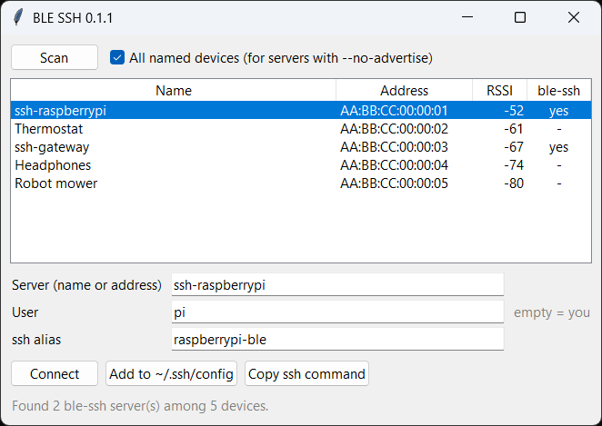

# ble-ssh-client (Python)

Cross-platform client for [ble-ssh](../../README.md): use SSH over Bluetooth LE from
Windows, macOS or Linux. Same command line as the C client, built on
[bleak](https://github.com/hbldh/bleak).

```bash
pipx install ./clients/python          # or: pip install ./clients/python
ssh -o ProxyCommand="ble-ssh-client AA:BB:CC:DD:EE:FF" pi@server
```

### Install from a release

Step by step for Windows, Linux and macOS: [docs/install.md](../../docs/install.md).

Every GitHub release has the client as one wheel for Windows, macOS and Linux, so no
checkout is needed (Python 3.10+ and [pipx](https://pipx.pypa.io/)). This installs
`ble-ssh-client` and `ble-ssh-gui`:

```bash
pipx install https://github.com/<owner>/<repo>/releases/download/v0.1.3/ble_ssh_client-0.1.3-py3-none-any.whl
```

The pre-release `main-latest` has the newest build of main. Its wheel's version carries the
commit (e.g. `0.1.2+g9fc43be`), so look the name up in `SHA256SUMS`:

```bash
b=https://github.com/<owner>/<repo>/releases/download/main-latest
pipx install --force "$b/$(curl -fsSL "$b/SHA256SUMS" | grep -o 'ble_ssh_client-[^ ]*\.whl')"
```

```powershell
$b = "https://github.com/<owner>/<repo>/releases/download/main-latest"
$whl = (Invoke-RestMethod "$b/SHA256SUMS") -split "\s+" | Where-Object { $_ -like "ble_ssh_client-*.whl" }
pipx install --force "$b/$whl"
```

Run the same command again to update; `--force` replaces the installed version. Without
pipx, `python -m pip install --user --force-reinstall <URL of the wheel>` (on Windows
`py -m pip ...`) does the same.

Find servers and set up an ssh alias:

```console
$ ble-ssh-client --scan
NAME          ADDRESS            RSSI
ssh-server    AA:BB:CC:DD:EE:FF   -48

$ ble-ssh-client --ssh-config ssh-server --user pi >> ~/.ssh/config
$ ssh server-ble
```

On Windows, append with `Add-Content` instead: Windows PowerShell's `>>` writes UTF-16,
which ssh can't read.

```powershell
ble-ssh-client --ssh-config ssh-server --user pi | Add-Content -Encoding ascii $HOME\.ssh\config
```

## GUI

`ble-ssh-gui` is installed with the client: a small window to find a server and log in,
without typing addresses or `ProxyCommand`s.



```bash
ble-ssh-gui
```

- **Scan** lists ble-ssh servers live as they are heard (20 s; the button turns into **Stop**).
  Tick **All named devices** to see every named BLE device: a server started with
  `--no-advertise` runs behind another program's advertisement, and goes by that device's
  name. A device heard under several names (a server next to the device's own advertising)
  lists them all, as `ssh-server / Gadget-1234`, and is connected by address.
- **Connect** (or double-click a row) opens ssh in a new terminal window, with this client as
  `ProxyCommand` and `--progress`, so the window says what is happening while BLE connects.
  The window stays open after ssh exits, so errors can be read.
- **Add to ~/.ssh/config** saves the server as an ssh alias (it shows the block first and
  refuses an alias that already exists); after that, plain `ssh <alias>` works from any
  terminal. **Copy ssh command** puts the full command on the clipboard.
- The login user is remembered per server. Left empty, ssh uses your local user name, which
  is rarely the right one on the server.
- **Stream video** (Linux) plays the remote video as it arrives, without downloading a
  complete file first or asking for a save location. The target needs ffmpeg: it reads the
  file at playback speed and remuxes video into a pipe-friendly Matroska stream. No
  transcoding is done, so choose a video bitrate below the BLE link's throughput. Audio
  is omitted. Close the player or press Ctrl+C in the terminal to stop.
- **Stream camera** (Linux) reads the target's live HTTP camera feed through SSH over
  BLE/L2CAP, not through a direct PC-to-camera HTTP connection. The default source is
  `http://127.0.0.1:8080/camera`, where loopback refers to the target. Enable the target's
  camera broadcaster first (this action does not change its settings). Target ffmpeg
  scales/pads the feed to 320x180 at 10 fps, preserving aspect ratio (including a
  side-by-side stereo feed), and encodes MPEG-4 at 160 kbit/s with a
  200 kbit/s maximum rate setting. Audio is omitted; close the player to stop the
  streaming process. The broadcaster itself remains enabled.

Both video actions use the **C client** with `--l2cap`. Install ffmpeg on the PC for
`ffplay`, and run the target server with `--l2cap`. If `ble_ssh_client` is not on PATH,
select its executable (for example `build/ble_ssh_client`). SSH authentication and
host-key prompts appear in a terminal; the GUI stays responsive. Finish other BLE
sessions before starting. The C client can fall back to GATT; its verbose terminal
output shows which transport was actually used. General file transfers are left to
existing tools such as `scp` and `sftp` over an SSH alias, rather than a built-in file manager.
For device names containing spaces or SSH-special characters, video actions use a
stable hashed SSH hostname while passing the original name to the BLE client.
Addresses and SSH-safe names retain their existing SSH host identity.

The same video action can be run directly on Linux:

```bash
python -m ble_ssh_client.video AA:BB:CC:DD:EE:FF /tmp/video.mp4 ./video.mp4 \
    --user pi --client ./build/ble_ssh_client

python -m ble_ssh_client.video AA:BB:CC:DD:EE:FF /tmp/video.mp4 --stream \
    --user pi --client ./build/ble_ssh_client

python -m ble_ssh_client.video AA:BB:CC:DD:EE:FF http://127.0.0.1:8080/camera --camera \
    --user pi --client ./build/ble_ssh_client
```

In download mode, playback starts only after the complete file is verified. A failed
download leaves an existing destination untouched. Add `--no-play` to only download;
`--ssh-option KEY=VALUE` passes an SSH setting such as `HostKeyAlias=ssh-server`.
Downloads have a 30-minute timeout. Streaming has no whole-file checksum or time limit;
SSH protects transport integrity, and SSH/player failures are reported in the terminal.

Terminals: `cmd` on Windows, Terminal.app on macOS, and on Linux the desktop's
`x-terminal-emulator`, or ptyxis, gnome-terminal, kgx, konsole, xfce4-terminal or xterm.
tkinter ships with Python on Windows and macOS; on Debian/Ubuntu install `python3-tk`.

## Options

| Option | |
|--------|-|
| `ADDRESS\|NAME` | Bluetooth address, or the server's advertised name (`ssh-<hostname>`, or with `--no-advertise` the name of the program that advertises) |
| `-s, --scan` | List nearby ble-ssh servers by signal strength and exit (scans 5 s, or `--timeout`) |
| `-a, --all` | With `--scan`: list every named BLE device and mark the ble-ssh ones. A server started with `--no-advertise` hides behind another program's advertisement: find its name or address here |
| `--ssh-config` | Print a `~/.ssh/config` block (`Host <name>-ble`) for `ADDRESS\|NAME`, with this client's full path as `ProxyCommand` |
| `--user U`, `--alias A` | With `--ssh-config`: login user and `Host` alias |
| `-p, --pair` | Bond first, then reconnect (once, for servers with `--require-bonding`) |
| `-t, --timeout S` | Seconds to wait for the server (default 20) |
| `-r, --reliable` | Write-with-response (slower) |
| `--progress` | One status line per step on stderr (looking, connecting, connected); `--ssh-config` and the GUI turn it on |
| `-v, --verbose` | Detailed progress on stderr, with timestamps |

The C client's `--nus`, for servers that offer the Nordic UART Service (`--nus`, a console
prototype), isn't here yet; this client reaches a console server started without `--nus`.

The C client's `--l2cap` (sessions over an L2CAP channel, for servers started with
`--l2cap`) has no counterpart in the Python tunnel: bleak, and Windows itself, have no API
for LE L2CAP channels. The Python tunnel always uses GATT; the Linux video actions
instead delegate transport to the C client. Every server offers GATT, also next to L2CAP; see
[L2CAP channels](../../README.md#l2cap-channels---l2cap-prototype).

## Platform notes

- **Windows:** works with Windows' own OpenSSH (`ssh.exe`). Use the full path to
  `ble-ssh-client.exe` in `ProxyCommand` if it isn't on `PATH`.
- **macOS:** CoreBluetooth hides MAC addresses, so connect by advertised name, or by the
  device UUID that `ble-ssh-client -v` prints. The OS pairs on demand, so `--pair` isn't
  needed and is ignored.
- **Linux:** the [C client](../../README.md#client) has no Python dependency, but this one
  works too.
